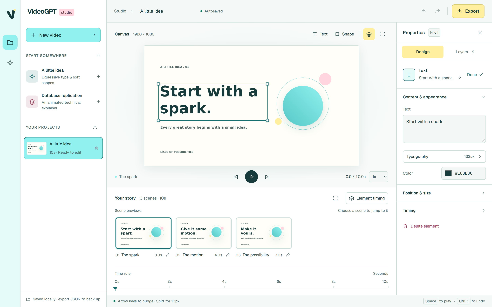
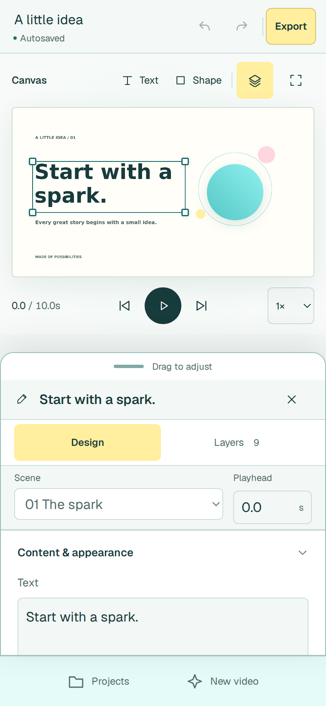

# VideoGPT Studio

Create short animated videos from a prompt or a template. Edit text, shapes,
and timing on the canvas and timeline, then export a video, animated GIF, or
editable project file.



## Run locally

Use Node.js 22 or newer. The repository pins Node.js 24 in `next/.nvmrc`.

```sh
cd next
npm ci
npm run dev
```

Open [http://localhost:3000](http://localhost:3000). The editor opens with
**A little idea**, a three-scene starter project. You can edit, play, and
export it without an API key.

### Enable prompt-to-video generation

Copy the environment template from the `next/` directory.

```sh
cp .env.example .env.local
```

Set `OPENROUTER_API_KEY` to your OpenRouter key and `DEFAULT_MODEL` to an
OpenRouter model ID in `.env.local`, then restart the dev server. The key stays
on the server. Choose **New video**, describe your idea, and pick a duration
of 5, 10, 15, or 20 seconds.

## Edit and export

1. **Start a project.** Choose a template from the library, import a project
   JSON, or generate a video from a prompt.
2. **Refine the scene.** Select a layer on the canvas or in **Properties → Layers**.
   Drag it to move it or use a corner handle to resize it. Hold Shift while
   resizing to preserve proportions. Use **Design** to edit text, colors,
   position, size, and timing.
3. **Review the motion.** Click a scene preview to jump to it, scrub the ruler
   to seek, or change the playback speed. Open **Element timing** to move or
   trim a layer’s visible interval. Use **Expand timeline** for more room
   or **Expand canvas** to focus on the artwork.
4. **Export.** Choose **Video** for MP4 or WebM, depending on browser support,
   **Animated GIF** for a 480-pixel-wide loop, or **Project file** for an editable
   JSON backup. Keep the tab visible during video export. The progress card
   lets you cancel an export.

<details>
<summary>See the phone editor</summary>

The adjustable Properties sheet keeps the canvas in view while you edit.



</details>

Projects and generation checkpoints are saved in IndexedDB in the current
browser. After interrupted generation, reopen the draft and choose
**Finish remaining scenes** to resume from the saved scenes. Use JSON export
and import to move a project between browsers. The project deletion notice
includes **Undo**.

### Sample export

Select **Database replication** in the template library to open this
10-second explainer. The GIF below was exported from the studio.


### Keyboard shortcuts

| Action | Shortcut |
| --- | --- |
| Play or pause | Space |
| Cycle through layers with the canvas focused | `[` or `]` |
| Nudge the selected layer | Arrow keys, or Shift + arrow for 10 px |
| Step through playback by 0.1 seconds with no layer selected | Left or Right arrow |
| Toggle Properties | I |
| Clear selection or exit the expanded canvas | Escape |
| Delete the selected layer | Delete or Backspace |
| Undo or redo | Ctrl/Command + Z or Ctrl/Command + Shift + Z |

Undo history holds up to 50 edits and resets on reload.

## Development

The Next.js app lives in `next/`. Use that directory as the Vercel Root Directory.

| Path within `next/` | Role |
| --- | --- |
| `src/components/studio/` | Editor, canvas, Properties, and timeline |
| `src/lib/project/` and `src/lib/workspace/` | Project format, templates, editing, undo, and browser storage |
| `src/lib/schema/` | Runtime schemas and TypeScript types |
| `src/lib/generation/` and `src/app/api/generate/` | Scene planning, generation, and the streaming API |
| `src/lib/rendering/` and `src/lib/export/` | Shared canvas renderer and browser encoders |
| `src/lib/evaluation/` | Generation evaluation cases and visual diagnostics |

Run the project checks from `next/`.

```sh
npm test
npm run typecheck
npm run lint
npm run build
```

With the development server running, install Chromium and run the browser
regression tests.

```sh
npx playwright install chromium
npm run test:ui
```

Set `UI_BASE_URL` to test another server or `E2E_CHROMIUM_PATH` to use an
existing Chromium executable. The [UI review record](docs/ui-review.md)
describes the interactions covered.

With OpenRouter configured, `npm run evaluate` runs eight generation cases and
writes project JSON, diagnostics, model identity, and timing to
`evaluation-artifacts/`.
