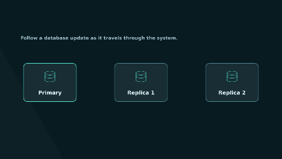

  

<h1 align="center">VideoGPT Studio</h1>

  Create short 2D animated videos from a prompt or template, then edit and export them in your browser.

  
  
  

  

<h2 align="center">Documentation</h2>

  <a href="docs/editor.md">Editor guide</a> ·
  <a href="docs/development.md#run-locally">Run locally</a> ·
  <a href="docs/development.md#development">Development</a>

<h2 align="center">Sample export</h2>

  Open <strong>Database replication</strong> under <strong>Projects</strong> to edit this 10-second explainer.

  

