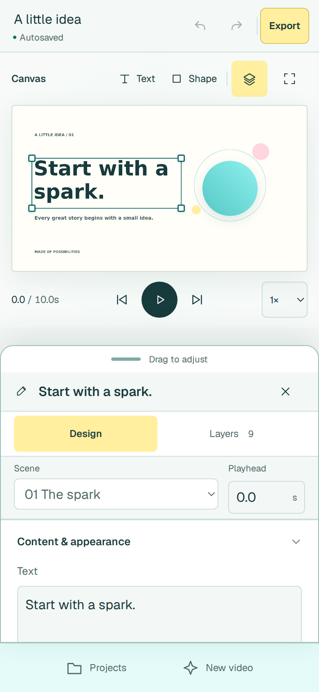

# VideoGPT Studio editor guide

## Start a project

- **Generate from a prompt.** Choose **New video**, describe your idea, pick a
  duration of 5, 10, 15, or 20 seconds, and click **Create video**. Generation
  uses the server’s OpenRouter settings. For local installs, see
  [Enable prompt generation](development.md#enable-prompt-generation).
- **Try a template.** On your first visit, edit the **A little idea** starter
  project or choose another template under **Projects**.
- **Open a saved project.** Use **Import JSON project** under **Projects**.

## Edit and export

1. **Refine the scene.** Select a layer on the canvas or in **Properties → Layers**.
   Drag it to move it or use a corner handle to resize it. Hold Shift while
   resizing to preserve proportions. Use **Design** to edit text, colors,
   position, size, and timing.
2. **Review the motion.** Click a scene preview to jump to it, scrub the ruler
   to seek, or change the playback speed. Open **Element timing** to move or
   trim a layer’s visible interval. Use **Expand timeline** for more room
   or **Expand canvas** to focus on the artwork.
3. **Export.** Choose **Video** to record an MP4 or WebM, depending on browser
   support. Keep the tab visible while recording, or use the progress card to
   cancel. If video recording is unavailable, choose **Animated GIF** for a
   480-pixel-wide loop. Choose **Project file** for an editable JSON backup.

See the phone editor

The adjustable Properties sheet keeps the canvas in view while you edit.

## Saving and resuming projects

The studio saves projects and generation checkpoints in the current browser
using IndexedDB. Export a **Project file** to back up your work or move it to
another browser. If generation stops after saving some scenes, reopen the draft
and choose **Finish remaining scenes**. The project deletion notice includes
**Undo**.

## Keyboard shortcuts

| Action | Shortcut |
| --- | --- |
| Play or pause | Space |
| Cycle through layers with the canvas focused | `[` or `]` |
| Nudge the selected layer | Arrow keys, or Shift + arrow for 10 px |
| Step through playback by 0.1 seconds with no layer selected | Left or Right arrow |
| Toggle Properties | I |
| Clear selection or exit the expanded canvas | Escape |
| Delete the selected layer | Delete or Backspace |
| Undo or redo | Ctrl/Command + Z or Ctrl/Command + Shift + Z |

Undo history holds up to 50 steps and resets on reload.
